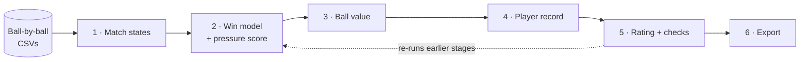

<p align="center">
  
</p>

<p align="center">
  
  
  
</p>

> Every T20 has a handful of balls that decide it. This repo finds those balls in ball-by-ball data,
> works out what each one was worth, and ranks the batters and bowlers who are reliably good on them.

---

## The idea in three lines

| | |
|---|---|
| **Pressure is a ball, not an over.** | A ball is under pressure when the match can still go either way *and* this delivery can swing it. The 19th over of a dead chase doesn't count. |
| **"Rising to the occasion" doesn't repeat.** | A player's extra lift under pressure in one half of his matches says almost nothing about the other half. Being good does carry over, so that's what the rating trusts. |
| **A ranking shouldn't hang on small choices.** | Every stage is re-run with other seeds, thresholds and data cuts. A name only counts if it survives. |

## How it works



1. **Match states.** One row per ball: score, wickets, balls left, target, team strength (Elo) and how the venue usually scores.
2. **Win model.** Two LightGBM models (batting first, chasing) give the win chance before every ball. Each match is scored by a model that never saw it. The *pressure score* is how far that chance can move on the next ball, compared with an average ball. A pressure ball is **winnable** (15–85%) and **tough** (top 15% of pressure scores).
3. **Ball value.** Each outcome gets its average worth in that kind of situation, an idea called linear weights in baseball. There are credit rules for wides, byes and run-outs, and a small adjustment for opponent quality.
4. **Player record.** Each player gets a pressure record, plus a usual level from the *same overs* (so a finisher is compared with his own death overs). Small samples are pulled toward the average.
5. **Rating and checks.** Both parts are weighted equally, and players are ranked on a cautious rating from 300 match resamples. This stage also runs the checks:
   - a clock test using ball timestamps
   - a split-half repeatability test
   - a forecast test, trained on 2022–24 and scored on 2025–26
   - sensitivity runs
6. **Export.** Writes the final tables, the figures and a player-level JSON for the dashboard.

## Run it

Put the SupeRR Selector data pack CSVs at
`6af458274c1e8_data_pack/Data Pack/`, or point `PP_DATA` at the folder that holds them.

```bash
pip install -r requirements.txt
python run_all.py            # all six stages, about 25 min
python run_all.py --from 4   # resume from a stage
```

Results land in `outputs/`.

## Layout

```
run_all.py                  runs the six stages in order
requirements.txt
src/
  common.py                 paths, every threshold, small helpers
  stage1_match_states.py
  stage2_win_model.py
  stage3_ball_value.py
  stage4_player_ratings.py
  stage5_validation.py
  stage6_export.py
assets/banner.svg
```

Every threshold lives in `src/common.py`. Change one and re-run to see what moves.

## Borrowed ideas

<details>
<summary>Where the method comes from</summary>

- **Leverage and linear weights.** Tango, Lichtman and Dolphin, *The Book* (baseball).
- **Importance of a point.** Morris (1977); Klaassen and Magnus (2001) (tennis).
- **Clutch rarely repeats.** Baseball clutch-hitting studies; choking studies in darts (Klein Teeselink et al., 2020) and biathlon (Lindner, 2017).
- **Time between deliveries as a pressure signal.** Jackson (2003), goal-kicking at the Rugby World Cup.
- **Context-adjusted T20 value.** Davis, Perera and Swartz (2015); cricWAR.

</details>

---

<p align="center"><sub>Built for SupeRR Selector Season 2 (Rajasthan Royals × Unstop).</sub></p>
